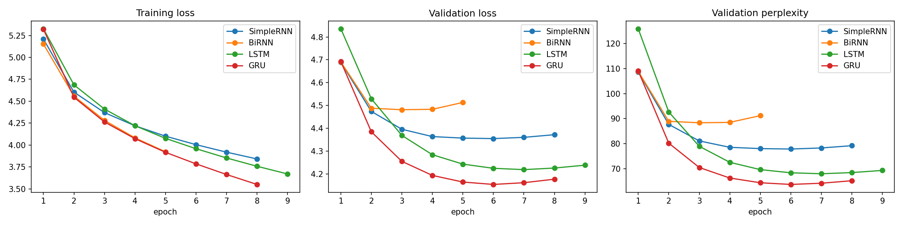
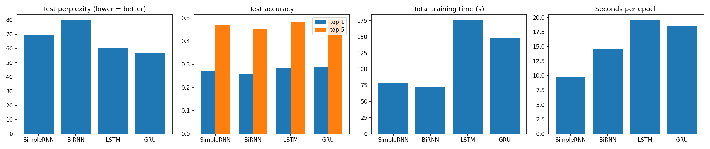
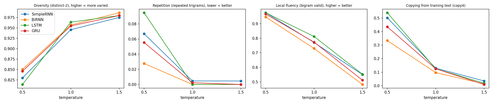

# Autoregressive Word-Level Text Generation: SimpleRNN vs BiRNN vs LSTM vs GRU

Foundations of Generative AI (ICT4403), Assignment 2

**Author:** Venisa Ivan Tellis | **Reg. No.:** 230911064

---

## 1. Problem statement and objective

Build an autoregressive text generator that predicts the next word from the previous words, then generates text one word at a time.
Train four recurrent models (Simple RNN, Bidirectional RNN, LSTM, GRU) under the same conditions and compare them on:

- **Prediction quality:** loss, perplexity, top-1 and top-5 accuracy
- **Cost:** training time
- **Generated text:** coherence, diversity, contextual consistency, repetition
- **Sampling temperature:** how generation changes at three temperatures (0.5, 1.0, 1.5), and which model is best overall for this dataset

## 2. Dataset

| | |
|---|---|
| Name | The Rámáyan of Válmíki, English verse translation by Ralph T. H. Griffith (1870 to 1874) |
| Source | Project Gutenberg eBook #24869 (public domain) |
| Link | https://www.gutenberg.org/ebooks/24869 |
| Plain text (used by the notebook) | https://www.gutenberg.org/ebooks/24869.txt.utf-8 |
| Size | about 2.3 MB of plain text |

**Characteristics:**

- An Indian epic written as English rhymed couplets, so lines are short and line endings matter
- Fixed cast of characters (Ráma, Sítá, Lakshman, Rávan, Hanumán) and many repeated epic phrases, which makes contextual consistency and repetition easy to judge in generated text
- Archaic poetic vocabulary and heavy punctuation
- Rank-frequency curve is Zipf-like: a few tokens (`<nl>`, `,`, `the`, `and`) are very common and a long tail of words appears once or twice (see `results/dataset_stats.png`)
- The Gutenberg text also contains canto titles (for example "Canto LXIII. Rama's Lament") and Griffith's scholarly notes. I did not remove them, and they show up in the generated text (see sections 6 and 8)
- Total tokens: `<fill from notebook output>` | Unique tokens: `<fill>` | Vocabulary after `MIN_FREQ = 3`: 7,361 (including `<unk>`) | Train / val / test windows: `<fill>`

**Preprocessing:**

1. Remove the Project Gutenberg licence header and footer
2. Strip accents (`Ráma` becomes `rama`), remove page markers like `[pg 001]` and digits (footnote numbers stuck to words), lowercase, collapse blank lines
3. Tokenize into words, the punctuation marks `. , ! ? ; :`, and a `<nl>` token for line breaks
4. Cut the tokens into blocks of 1,000, shuffle the blocks, and give 90% to train, 5% to validation, 5% to test. Windows are built inside each block so test text never overlaps with training text
5. Build the vocabulary from the train split only. Words seen fewer than 3 times become `<unk>`. `<unk>` is blocked during generation
6. Sliding window with stride 1: input = 10 previous tokens, target = the next token

## 3. Models

All four use the same pipeline: `Embedding(128)` -> recurrent layer (256 units) -> `Dropout(0.3)` -> `Dense(vocab, softmax)`.

| Model | Recurrent layer | Notes |
|---|---|---|
| SimpleRNN | `SimpleRNN(256)` | Plain recurrence, prone to vanishing gradients |
| BiRNN | `Bidirectional(SimpleRNN(256))` | Reads the 10-word context forward and backward. It never sees the target word, so it is still autoregressive. More parameters than the others |
| LSTM | `LSTM(256)` | Gated cell state for longer memory |
| GRU | `GRU(256)` | Gated, fewer parameters than LSTM |

**Same training setup for all:** Adam (lr 1e-3, gradient clipping 1.0), batch size 256, up to 20 epochs, early stopping on validation loss (patience 2, best weights restored), seed 42.

## 4. How to run

```bash
git clone <this repo>
cd <repo folder>
pip install -r requirements.txt
jupyter notebook FGAI_Assignment2_TextGeneration.ipynb
```

Then run all cells. The notebook downloads the dataset itself (internet needed). I ran it on Kaggle with a GPU (T4 x2) and internet turned on. On CPU it will be slow.
Set `QUICK_TEST = True` in the config cell for a tiny run that only checks the code works.

Outputs go to `results/`:

| File | Content |
|---|---|
| `metrics.csv`, `results_tables.md` | Test loss, perplexity, accuracy, training time, rankings |
| `training_curves.png`, `model_comparison.png` | Curves and bar charts |
| `generated_samples.md`, `generated_samples.csv` | All generated text with per-sample metrics |
| `temperature_metrics.csv`, `temperature_analysis.png` | Metrics by model and temperature |
| `dataset_stats.png` | Dataset characteristics |

Dependencies: Python 3.10+, TensorFlow 2.16+ (Keras 3), numpy, pandas, matplotlib, jupyter.

## 5. Results

Test split results. Perplexity is `exp(test loss)`, so lower is better.

| Model | Params | Epochs run | Best epoch | Train time (s) | Sec / epoch | Test loss | Test perplexity | Top-1 acc | Top-5 acc |
|---|---|---|---|---|---|---|---|---|---|
| SimpleRNN | 2,932,545 | 8 | 6 | 78.3 | 9.8 | 4.240 | 69.42 | 0.270 | 0.469 |
| BiRNN | 4,915,521 | 5 | 3 | 72.7 | 14.5 | 4.379 | 79.72 | 0.256 | 0.451 |
| LSTM | 3,228,225 | 9 | 7 | 175.5 | 19.5 | 4.100 | 60.36 | 0.283 | 0.484 |
| GRU | 3,130,433 | 8 | 6 | 148.6 | 18.6 | 4.040 | 56.80 | 0.289 | 0.490 |

Unigram baseline (ignores the context, uses word frequencies only): test perplexity 333.0, top-1 accuracy 0.117. All four models are far better than this. GRU's perplexity is about 6 times lower and its top-1 accuracy about 2.5 times higher.




## 6. Model comparison and evaluation

**Prediction quality.** GRU is best on every prediction measure: perplexity 56.80, top-1 accuracy 28.9%, top-5 accuracy 49.0%. LSTM is second (60.36), SimpleRNN third (69.42) and BiRNN last (79.72). The two gated models clearly beat plain recurrence: GRU's perplexity is about 18% lower than SimpleRNN's and LSTM's is about 13% lower. GRU beats LSTM by about 6%, which is a smaller gap and comes from a single run.

**BiRNN.** The bidirectional model has the most parameters (4.9M, about 1.7 times SimpleRNN) and still came last, with perplexity about 15% worse than SimpleRNN. It reached its best validation loss at epoch 3 and early stopping ended training at epoch 5, which suggests it overfits quickly. A likely reason is that the input window only holds past words, so reading it backwards adds capacity without adding new information.

**Training time.** BiRNN (72.7 s) and SimpleRNN (78.3 s) have the shortest total time, but only because early stopping ended them after 5 and 8 epochs. Per epoch, SimpleRNN is cheapest (9.8 s), BiRNN costs 14.5 s, and GRU (18.6 s) and LSTM (19.5 s) cost about twice as much as SimpleRNN. GRU finished in 148.6 s against 175.5 s for LSTM (about 15% less), so it is both faster and better.

**Generated text, automatic measures.** At temperature 1.0 the models are close. LSTM has the highest fluency proxy (`bigram_valid` 0.812), then GRU (0.773), SimpleRNN (0.771) and BiRNN (0.730). BiRNN has the lowest `bigram_valid` at all three temperatures, which fits its weaker perplexity. Repetition is almost zero for every model at 1.0 (`rep_trigram` 0.000 to 0.005), but `rep_trigram` does not catch loops like repeated canto titles. `bigram_valid` only checks whether word pairs occur in the training text, so it also rewards copying. Reading the samples is a better guide than these proxies.

**Generated text, my ratings.** From reading the samples at temperature 1.0 (1 to 5, 5 is best, repetition 5 means almost none):

| Model | Coherence | Diversity | Contextual consistency | Repetition | Notes |
|---|---|---|---|---|---|
| SimpleRNN | 2 | 3 | 2 | 2 | Loops on canto titles ("canto lxv. rama's name. canto iii. sugriva for.") |
| BiRNN | 2 | 4 | 2 | 4 | Most broken grammar, many fragments, lowest fluency proxy at every temperature |
| LSTM | 3 | 4 | 3 | 4 | Some good lines, but one sample drifted into notes-style prose |
| GRU | 3 | 4 | 3 | 4 | Kept the verse layout best, one sample rhymed ("aid" / "blade") |

Automatic text measures (computed on generated words only): `distinct1` / `distinct2` (diversity), `rep_trigram` (share of repeated trigrams), `bigram_valid` (share of generated word pairs that occur in the training text), `copy4` (share of 4-word chunks copied from the training text). These are proxies. Contextual consistency over a long span can only be judged by reading, and with a 10-word window none of the models keeps a topic for more than a line or two.

All four models learned the names and world of the epic (raghu, bharat, kausalya, sugriva, vanar, indrajit, kumbhakarna). The training text also contains canto titles and scholarly notes, so the models sometimes produce things like "canto iii. rama's hermitage.", "bengal recension" or "history of his incarnation".

## 7. Sampling-temperature analysis

Every model was run from the same three seeds at temperatures 0.5, 1.0 and 1.5 (3 samples per setting, 50 words each). Mean text measures per model and temperature:

| model | temperature | distinct1 | distinct2 | rep_trigram | bigram_valid | copy4 |
|---|---|---|---|---|---|---|
| BiRNN | 0.5 | 0.551 | 0.850 | 0.028 | 0.946 | 0.333 |
| BiRNN | 1.0 | 0.729 | 0.957 | 0.000 | 0.730 | 0.097 |
| BiRNN | 1.5 | 0.836 | 0.986 | 0.000 | 0.483 | 0.014 |
| GRU | 0.5 | 0.564 | 0.846 | 0.056 | 0.966 | 0.435 |
| GRU | 1.0 | 0.738 | 0.955 | 0.002 | 0.773 | 0.125 |
| GRU | 1.5 | 0.827 | 0.980 | 0.000 | 0.512 | 0.009 |
| LSTM | 0.5 | 0.527 | 0.814 | 0.095 | 0.975 | 0.539 |
| LSTM | 1.0 | 0.709 | 0.964 | 0.000 | 0.812 | 0.125 |
| LSTM | 1.5 | 0.847 | 0.980 | 0.000 | 0.553 | 0.019 |
| SimpleRNN | 0.5 | 0.522 | 0.830 | 0.067 | 0.975 | 0.501 |
| SimpleRNN | 1.0 | 0.720 | 0.946 | 0.005 | 0.771 | 0.130 |
| SimpleRNN | 1.5 | 0.802 | 0.975 | 0.005 | 0.551 | 0.035 |



Example, GRU, seed "ravan the demon king, with eyes of flame, drew near":

```
T = 0.5
and thus the vanar monarch spake
to rama, lord of men, his speech
would never failed to soothe his way.

T = 1.0
though bid him go by these and host
thrust urge thine stream to ride.
canto iii. rama's hermitage.

T = 1.5
me therefore was silk gandharvi: medicinal blossom keener
scan appears deserves away means sold in due the cost which wood
```

**Temperature 0.5 (safe, repetitive, copies the book).** The text reads like normal verse and uses common words ("the king", "the lord", "the son"), and it stays inside the epic. But it loops, and much of it is lifted from the training text: on average 45% of the 4-word chunks (`copy4`) are copied word for word, up to 54% for LSTM, and `bigram_valid` is about 0.97. LSTM also repeats the most (`rep_trigram` 0.095) and BiRNN the least (0.028). Examples from the samples: SimpleRNN wrote "canto lxiii. rama's lament. canto lxv. rama's lament." in one sample, LSTM wrote "i, i have i have seen", BiRNN "when, when" and GRU "to be ... to be compared".

**Temperature 1.0 (best balance of the three).** Diversity is high (`distinct2` about 0.96), repetition is almost gone, copying drops to about 12%, and fluency is still moderate (`bigram_valid` about 0.77). Lines keep a verse length of about 6 to 8 words with line breaks like the original. Some lines are good ("the hapless daughter of the sky", "a glorious pair is mine to thee"), and GRU produced a rhyme in one sample. Grammar is often wrong and the meaning does not carry from one line to the next.

**Temperature 1.5 (too random).** Diversity is highest (`distinct2` 0.975 to 0.986) but only about half of the word pairs occur anywhere in the book (`bigram_valid` 0.48 to 0.55) and almost nothing is copied (`copy4` 0.01 to 0.04). The text turns into strings of rare names and old words ("kasyap", "ikshvaku", "visvakarma", "gandharvi"), strange punctuation (";,") and irregular line breaks. LSTM and GRU sometimes ran several lines together. I could not tell the four models apart by reading here.

**Summary.** Raising temperature trades repetition and copying for incoherence. Across the four models, `distinct2` goes from about 0.84 to 0.96 to 0.98 and `bigram_valid` from about 0.97 to 0.77 to 0.52 as temperature goes from 0.5 to 1.0 to 1.5. All four models react the same way, and the differences between models are easiest to see at 0.5 and 1.0. A value between 0.5 and 1.0 (for example 0.7) would probably give the best text, but I only tested 0.5, 1.0 and 1.5.

## 8. Conclusion

**Best-performing model: GRU.**

- It has the lowest test perplexity (56.80, about 6 times lower than the unigram baseline of 333.0) and the highest top-1 and top-5 accuracy (28.9% and 49.0%)
- It trained faster than LSTM (148.6 s against 175.5 s) with slightly fewer parameters (3.13M against 3.23M)
- On generated text GRU and LSTM are close. LSTM has the higher fluency proxy at temperature 1.0 (0.812 against 0.773), but it also copies and repeats more at temperature 0.5 (`copy4` 0.539 against 0.435, `rep_trigram` 0.095 against 0.056). In the samples GRU kept the verse layout best and produced a rhymed couplet in one sample

Limitations:

- The context window is only 10 words, so none of the models can keep a story or topic going
- The training text still has canto titles and scholarly notes, which leak into the generated text. Removing them would make the comparison cleaner
- Each model was trained once with one seed. Two runs of the notebook gave slightly different numbers (for example BiRNN perplexity 79.1 and 79.7) with the same model ranking, and the GRU vs LSTM gap (about 6% in perplexity) is small enough that another seed could change it
- The automatic text measures are rough proxies and the 1 to 5 ratings are my own judgement from a small number of samples

## Repository layout

```
.
├── FGAI_Assignment2_TextGeneration.ipynb
├── README.md
├── requirements.txt
└── results/            (created when you run the notebook)
```

`models/` and `data/` are also created when the notebook runs. They do not need to be pushed to GitHub (the dataset is downloaded from the link above).
